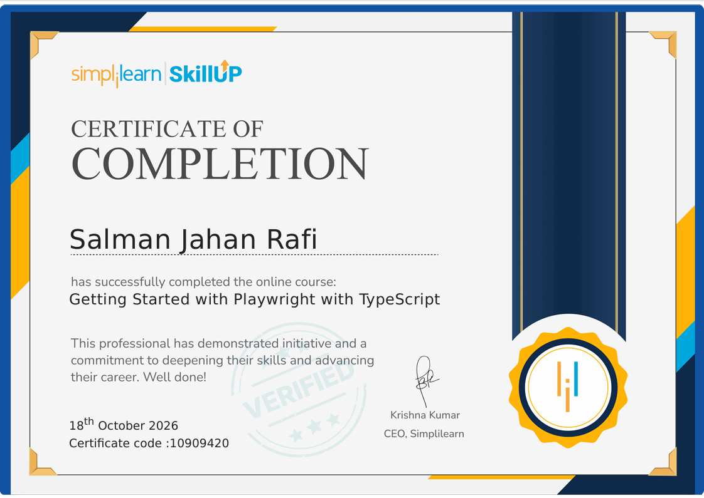

# Playwright with TypeScript — Certification

### Simplilearn SkillUp | Course Completion Certificate

This repository showcases my successful completion of the **Getting Started with Playwright with TypeScript** course offered by **Simplilearn SkillUp**.

The course supports my ongoing professional development in Software Quality Assurance (SQA) and Test Automation.

## Certificate Details

| Information | Details |
|---|---|
| Course | Getting Started with Playwright with TypeScript |
| Issuing Organization | Simplilearn SkillUp |
| Issue Date | October 18, 2026 |
| Credential ID | 10909420 |
| Credential Type | Course Completion |

## Certificate

[View My Certificate (PDF)](./QA_Automation_Certificate.pdf)

## Learning Focus

- Playwright fundamentals
- TypeScript for web test automation
- Introduction to automated web testing
- Continuous learning in software quality assurance

## Professional Development

I am continuing to strengthen my QA Automation skills through practical projects, test framework development, and hands-on experience with modern testing tools.

---

*Committed to continuous learning and building reliable software through effective testing.*
